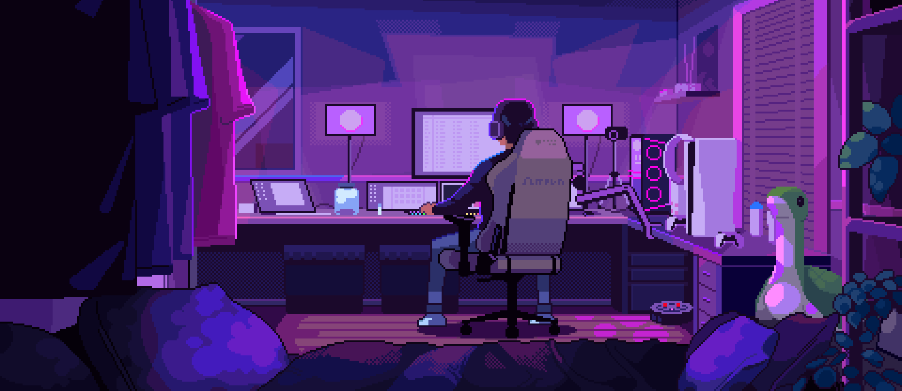

 

  

  <b>`داتاアナリスト`</b>
  <samp>
       
      Hi there! I'm <b>Anas Arrak</b>
  </samp>

  

 

  

      
 
 

 
  
  
  
  
  
  
  
  
  
  
  

 
 

  
  

      <samp>
        <b>More Info</b>
      </samp>
  

  
 

##

 

  <samp>
    <b>
      Contact me:
    </b>
  </samp>
   
   

  
  

 

##

 

  

  

 

 
 

 

  <code>some animated contribution graphs <b>༼ つ ◕_◕ ༽つ</b></code>

 

<picture>
  <source media="(prefers-color-scheme: dark)" srcset="https://raw.githubusercontent.com/divyanshudhruv/divyanshudhruv/output/graphs/bomberman-contribution-graph-dark.svg">
  <source media="(prefers-color-scheme: light)" srcset="https://raw.githubusercontent.com/divyanshudhruv/divyanshudhruv/output/graphs/bomberman-contribution-graph.svg">
  
</picture>
  
    

  <!-- صورة الكود المتحركة -->
  

    

  <!-- عنوان الرسم الثلاثي الأبعاد -->
  

    <code>3D contribution stats <b>(⌐■_■)</b></code>
  

   
  
  <!-- الرسم الثلاثي الأبعاد -->
  

